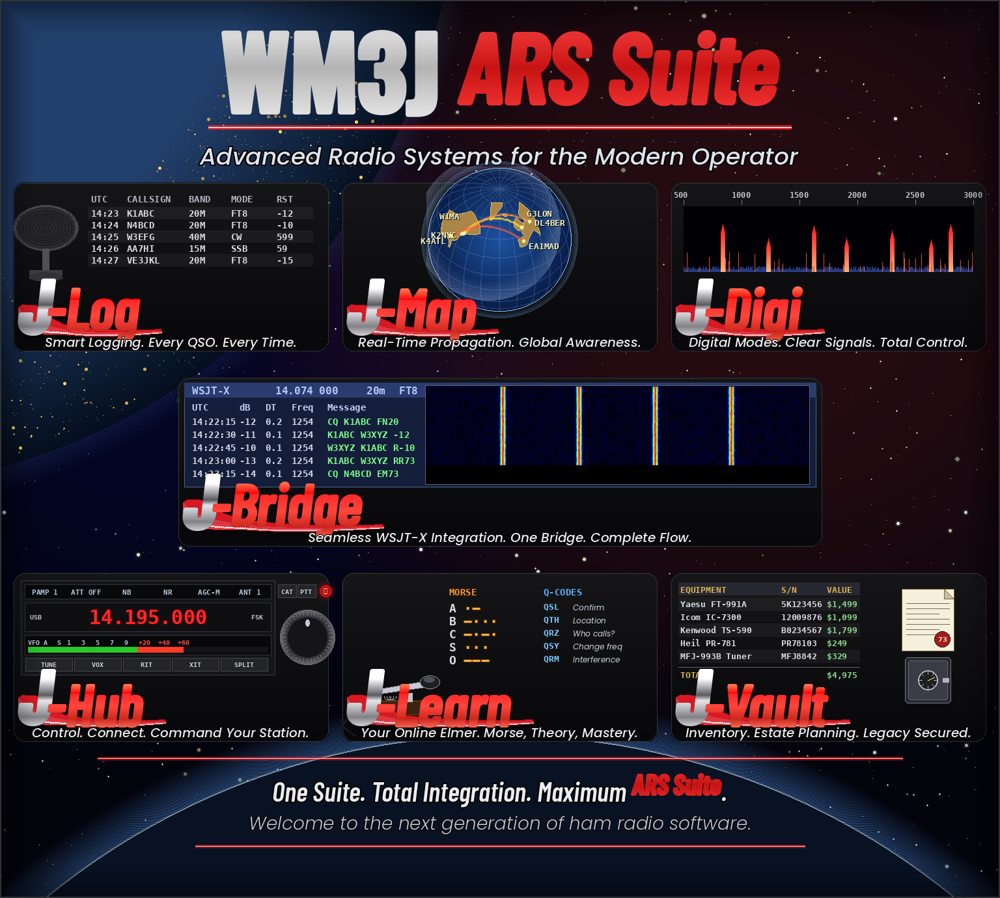

<p align="center">
  
</p>

# WM3J‑ARS‑Suite

[](https://www.gnu.org/licenses/gpl-3.0)
[](https://adoptium.net/temurin/releases/?version=21)
[](#)

> **A modern, modular, operator‑first amateur radio suite.**
> One JavaFX application that runs your whole shack — **docked** in a single
> window, or with each module **loose** in its own window sharing one
> background hub. One config, one cluster connection, one set of credentials.

WM3J‑ARS‑Suite is a complete, integrated software ecosystem for the modern
ham. Logging, mapping, digital modes, WSJT‑X integration, satellite tracking,
inventory, an in‑app reference library, and antenna design — all written in
Java, all GPLv3, all in **one application** instead of a dozen separate
programs.

> **New in 2.0 — contesting has its own program.** Contest logging moved out of this suite
> into **[ARS Contest](https://github.com/skip17331/WM3J-Contest-Suite)**, so that it can be done
> properly. J‑Log here is now the everyday log. [Why, and what it means for you ↓](#contesting--its-own-program-ars-contest)

---

**Just want to install it?** → **[INSTALL.md](INSTALL.md)** — download a
release jar, or build from source with menu shortcuts, on Linux, Windows,
macOS and Raspberry Pi.

**Already installed?** → **[USER_GUIDE.md](USER_GUIDE.md)** — app
walkthrough, per‑module setup notes and troubleshooting.

**Wiring your radio, rotator, amp, or antenna switch?** →
**[docs/HARDWARE_GUIDE.md](docs/HARDWARE_GUIDE.md)** — beginner‑friendly
guide to USB‑to‑serial adapters, Hamlib daemons, USB hubs, stable port
names, and common gotchas.

**License and notices:** [GPL v3](LICENSE) · [Code of Conduct](CodeOfConduct.md) · [Legal & privacy notes](LEGAL.md)
· to have a source added to or removed from the Info feeds, write to
[wm3jmike@gmail.com](mailto:wm3jmike@gmail.com).

**Website and code:** **[wm3j.net](https://www.wm3j.net)** ·
**[GitHub repositories](https://github.com/skip17331?tab=repositories)** —
[WM3J-ARS-Suite](https://github.com/skip17331/WM3J-ARS-Suite) (this project),
[WM3J-Contest-Suite](https://github.com/skip17331/WM3J-Contest-Suite) (ARS Contest: the contest program that grew out of this suite),
[WM3J-ARS-Plugin-Builder](https://github.com/skip17331/WM3J-ARS-Plugin-Builder) (editor for contest and award plugins),
[GoKit](https://github.com/skip17331/GoKit) (emergency communications: APRS, Winlink, packet) and
[wireworks](https://github.com/skip17331/wireworks) (antenna modeling and design).

---

## What's in the box

One app, these modules — each a surface you can dock or float in its own window.

| Module | What it does |
|---|---|
| **J‑Hub** | The control surface: dashboard, DX cluster + RBN with spot alerts, callsign lookups, macros, log uploaders, and **Setup**, the one screen for every setting (Settings in the dock). |
| **J‑Log** | The everyday QSO logger: logbook, awards, uploads (LoTW, eQSL, QRZ, Club Log), QSL labels. Contesting has its own program, [ARS Contest](https://github.com/skip17331/WM3J-Contest-Suite). |
| **J‑Map** | Real‑time DX map (flat, azimuthal or 3D globe) with grayline, beacons, propagation estimates and great‑circle paths to spotted DX. |
| **〰 J‑Digi** | Classic keyboard‑to‑keyboard digital modem: RTTY, PSK31, Olivia, MFSK16, DominoEX, CW and AX.25 packet. (FT8 lives in J‑Bridge.) |
| **⇄ J‑Bridge** | WSJT‑X integration. Forwards QSOs, spots, status, and frequency back into the suite over UDP. |
| **J‑Sat** | Satellite tracker with Doppler correction and rotor control. |
| **J‑Vault** | Shack inventory + **first‑call contacts** so your family knows who to call when you're SK, with a **printable estate document** and CSV export. SQLite‑backed. |
| **J‑Learn** | Embedded amateur‑radio reference library — 30 chapters, 300+ sections covering propagation, antennas, RF safety, troubleshooting, formulas, operating practice, emcomm. Searchable; markdown source seeds to `~/.j-learn/content/` so you can edit content without rebuilding. |
| **Morse Trainer** | Learning and practicing CW — Koch‑method letter trainer, QSO simulator, sending trainer with real‑time decoding, analytics, and optional Arduino / Pi keyer hardware support. |

A shared **j‑log‑engine** library underpins logging across J‑Log, J‑Digi,
and J‑Bridge so everything writes to one set of databases under `~/.j‑log/`.
Docked or loose, the windows attach to a small **background hub** (in the
system tray) that owns the radio daemons and the live feeds, so they all
share one set of spots, rig, rotor and station identity, and closing a window
never drops the radio.

---

## Highlights

### Antenna Workshop (opens in J‑Learn; its own dock entry)

A **questionnaire‑driven antenna recommender** + **13 live calculators**:

- **Recommender** — answers a handful of questions about your QTH, HOA
  status, bands, height, stealth needs, and budget, then ranks antennas
  that actually fit.
- **Calculators** — flat dipole · inverted‑V · fan dipole · trapped dipole ·
  OCF/Windom · EFHW (with and without traps) · J‑pole · Yagi‑Uda · vertical ·
  loading coils · trap design · magnetic loop · NanoVNA trim workflow.
- **Per‑formula calculators** for J‑Learn's Formulas chapter — Ohm's law,
  power, reactance, impedance, resonance, wavelength, SWR, ERP, feedline
  loss, decibels, Q factor, bandwidth, Smith chart, RF exposure.

Click a chapter card in J‑Learn → it opens the matching calculator
pre‑filled with sane defaults.

### J‑Vault — the SK problem, solved

When an operator becomes a Silent Key, families inherit a shack of expensive
gear they don't recognize. J‑Vault keeps a categorized **equipment inventory**
(make / model / serial / value / disposition / location) alongside
**first‑call contacts** — the people who should be called, priority‑sorted, and
the gear each is interested in. **Estate document** turns it into one printable
page for your family — what to do first (no rush, don't climb the tower, call
these people), the contacts with their phone numbers, and the inventory with
estimated values — to print or save as PDF and keep with your papers. Also
exports to CSV.

### J‑Learn — your reference library, in‑app

Thirty chapters and more than 300 sections, written for operators who already
have their license. Searchable, with an Advanced toggle for engineering
depth. Cross‑references jump straight to the calculator or sub‑section
you need. Bundled into the app — no separate install, no internet required.

### Contesting — its own program, ARS Contest

Up to 1.x, J‑Log also had a contest mode. In **2.0** it moved out of this suite into a program of its own,
**[ARS Contest](https://github.com/skip17331/WM3J-Contest-Suite)**. That was a deliberate choice, not a removal.

**Why it was moved.** Running a contest is a different job from running a shack, and doing the contest side
justice takes a program built around it: a screen laid out for the exchange you are copying, a keyboard flow
fast enough for a pileup, each sponsor's scoring rules and multiplier lists (86 contests), a log kept per
contest, several stations sharing one log, and a Cabrillo file the sponsor's robot accepts. Kept inside this
suite, all of that had to share screens, Setup pages, a settings file, a release cycle and a place in the dock
with J‑Digi, J‑Sat, J‑Vault and J‑Learn, so the contest side could never be given the focus it deserved, and
every other module carried its weight. As its own program ARS Contest can be built, released and versioned at
the pace of contests, and this suite stays what it is meant to be: the whole shack, with an everyday log.

**What is where**

| | ARS Suite (this project) | ARS Contest |
|---|---|---|
| Everyday logbook, awards, uploads (LoTW, eQSL, QRZ, Club Log), QSL labels | ✔ | |
| DX cluster / RBN, J‑Map, J‑Sat, J‑Digi, J‑Bridge, J‑Vault, J‑Learn, Morse Trainer | ✔ | |
| Info page with the contest *calendar* (WA7BNM) | ✔ | the rules of the open contest, and the calendar |
| Contest page and custom cockpit, 86 contest definitions, validation, dupes, multipliers | | ✔ |
| Super Check Partial, call history that fills the exchange, CW / voice F‑keys, Morse send / receive bar | | ✔ |
| Contest network (several stations, one log), N1MM+ broadcast, Cabrillo / ADIF / CSV export | | ✔ |

**Running both.** They install side by side on one PC. ARS Contest keeps its data in `~/.ars-contest`
(this suite uses `~/.j-hub` and `~/.j-log`), its hub listens on port 8091 (this suite's on 8090), and its
shortcuts sit in **Amateur Radio ▸ Contest Suite** next to this suite's **Amateur Radio ▸ ARS Suite**. The first
time ARS Contest runs it copies your station, rig, rotor, amplifier, transmit and cluster settings from this suite
(it only reads them; lookup logins and the hub port are not copied). ARS Contest can also be pointed at this
suite's hub (Setup ▸ Remote sharing in ARS Contest) so one rig connection and one cluster feed serve both; that has
been tried with stand‑ins, not yet in a real session.

**Your old contest logs** were not deleted. `~/.j-log/contest.db` and `~/.j-log/contest-logs/` are left exactly as
they were, and nothing in this suite reads them any more. To bring one into ARS Contest, close both programs, copy
the database file (with any `-wal` and `-shm` files beside it) into `~/.ars-contest/contest-logs/` under a new name,
and start ARS Contest: the log appears under "continue" when you open its contest.

### DX spotting

One DX‑cluster and RBN connection serves every module. Spots are tagged
**NEW ONE / NEW BAND / NEW MODE** against your log, **spot alerts** pop up
(with a chime) for your watch list or anything you need, and with a Club Log
key you get the **Most Wanted** rank on each spot and Club Log's DXCC
exceptions for odd DXpedition calls.

### One settings surface

Every operator preference lives in **Setup** inside the app — callsign, grid,
rig backend, Hamlib host/port, IARU region + country (for bandplan captions),
PTT method, CW WPM, DX cluster, log uploaders, macros. Reach it from
**Settings** in the dock. One place, no per‑app duplicate config files; in
loose mode the change reaches every window through the background hub.

### Languages

The app's screens are in English. The J-Log translator (QSO phrases with a pronunciation guide) covers
Spanish, German, French, Italian and Portuguese.

### Macros that share state

Every app uses the same macro engine. `{CALL}` is the station you are working; every other tag comes from your
own settings — `{MYCALL}`, `{NAME}`, `{QTH}`, `{GRID}`, `{POWER}`, `{RIG}`, `{ROTOR}` and about forty more
(**Setup ▸ Transmit & macros** lists them) — so a message is built from the live station data, **not** from
per‑app duplicates. A tag whose setting is empty stops the message from being sent and says which one is missing.

### Log uploaders

Push QSOs from J‑Log to **LoTW** (signed with TrustedQSL), **eQSL.cc**,
**Club Log**, **QRZ Logbook**, **Wavelog**, **Cloudlog** and **HRDLog.net** with one click. LoTW and
eQSL can also upload each new QSO automatically, tracking which QSOs each
has already had; **Get confirmations** downloads your LoTW and eQSL
confirmations. Passwords and keys are kept in your operating system's
keyring (Windows Credential Manager, macOS Keychain, the Linux Secret
Service); where there is none, in owner‑only files (see [LEGAL.md](LEGAL.md)).

### Info page and QSO recording

The **Info** page gathers what is coming up and what is on now: contest and DXpedition calendars, ham-radio news, POTA activators
on the air (tagged when your log needs the entity or the park), your log's statistics, and sunrise / sunset and greyline times at
your station. **QSO recording** (off by default) keeps the last minutes of receive audio and saves the end of it as a WAV file with
each QSO you log.

### Phone web client and updates

A small web page lets a phone on your own network log QSOs (handy for POTA /
SOTA), watch the spots and see the rig; it is off until you switch it on. The
app checks GitHub once a day for a new release and, on Windows and Linux,
installs it for you.

### J‑Map

Real‑time DX spots on a flat, azimuthal or 3D‑globe map, with the grayline,
your beam heading and range rings, spot paths and station‑to‑station tracks,
the NCDXF beacons (with QSY and band hopping), who's hearing you, and a
path‑open estimate on each spot from the solar data. Shares one DX‑cluster
connection with the rest of the suite (one telnet connection serves every
module). Runs loose on a second machine as a dedicated shack display.

### J‑Sat

Doppler‑corrected satellite tracking with rotor control, pass prediction and
pass alarms, shown as a polar plot, a Blue Marble map or a 3D globe. Orbital
elements are downloaded and cached in `~/.j-sat/`.

---

## Why This Project Exists

Ham radio operators deserve modern, ergonomic, integrated tools that
work consistently across all platforms.

Most existing amateur‑radio applications are:

- platform‑specific
- visually inconsistent
- difficult to integrate
- built on aging UI frameworks
- not designed for contest‑grade workflows

WM3J‑ARS‑Suite takes a different approach: **one Java application with
cockpit‑style module surfaces, unified configuration, and universal backend
support.** One DX cluster connection shared by every module. One station
identity. One macro engine. One inventory. One reference library. Dock it all
in a single window, or float the modules you want — your choice.

---

## Quick install

**Full step‑by‑step instructions are in [INSTALL.md](INSTALL.md).**
The 30‑second version:

### Download a release (no build)

Install Java 21, download the jar for your system from the
[Releases page](https://github.com/skip17331/WM3J-ARS-Suite/releases)
and run it: `java -jar ars-fx-<version>-<system>.jar`. That is the whole
app; it keeps itself up to date on Windows and Linux. To get menu
shortcuts without building, download `j-installer-<version>.jar` from the
same page and run `java -jar` on it: it fetches the right app jar, checks
it and adds the shortcuts. Or build from source:

### Linux

```bash
# Debian family:  sudo apt update && sudo apt install -y git openjdk-21-jdk maven
# Fedora family:  sudo dnf install -y git java-21-openjdk-devel maven
git clone https://github.com/skip17331/WM3J-ARS-Suite.git ~/ARS_Suite
cd ~/ARS_Suite
./install.sh                       # builds the app + adds menu shortcuts
./ars-fx/ars-fx.sh                 # docked; or  --module log  (loose) / --hub (tray)
```

Shortcuts appear in **Amateur Radio ▸ ARS Suite** in your application menu
(GNOME, which has no folders, lists them directly) — **ARS Suite** (docked)
plus a window per module and **ARS Suite Hub**. Arch /
openSUSE / other distros — same flow, see [INSTALL.md](INSTALL.md) for the
package-manager line.

### Windows

**One command.** Install Git if you don't have it, clone, then run —
or just **double-click** — `install.bat`. It installs Java + Maven,
builds every module, and adds Start-Menu shortcuts.

```powershell
winget install --id Git.Git -e        # skip if you already have Git
git clone https://github.com/skip17331/WM3J-ARS-Suite.git $HOME\ARS_Suite
cd $HOME\ARS_Suite
.\install.bat                          # ~5–10 min first run; or double-click it
```

Then press the Windows key, type **ARS Suite**, and press Enter (or open a
single module's shortcut). Re-running `install.bat` after a `git pull` is the
upgrade path. JavaFX is bundled into the jar automatically — no SDK download.
If anything fails it writes `install-log.txt` — attach that to a GitHub issue.
Full walkthrough in [INSTALL.md](INSTALL.md).

### macOS

```bash
brew install --cask temurin@21
brew install maven git
git clone https://github.com/skip17331/WM3J-ARS-Suite.git ~/ARS_Suite
cd ~/ARS_Suite
./install.sh                              # detects Apple Silicon vs Intel
open ~/Applications/ARS\ Suite.app
```

`./install.sh` builds the matching jar for your Mac and plants a `.app` bundle
per shortcut in `~/Applications/` (**ARS Suite.app**, **J-Log.app**, …). First
launch may need a Gatekeeper unblock — see [INSTALL.md](INSTALL.md#macos).
Re-run after any `git pull` to upgrade. Per-window logs go to
`~/Library/Logs/ARS-Suite/`.

---

## Free and Open Source (GPLv3)

The entire suite is **free to use**, **free to modify**, and **free to
redistribute** under the **GNU General Public License v3 (GPLv3)**.

- the suite will always remain open and community‑driven
- improvements made by others stay open
- operators can customize for their own stations
- the codebase cannot be taken closed‑source

Same license as **Hamlib**, **WSJT‑X**, and **fldigi** — maximum
compatibility, long‑term openness.

---

## Technology Overview

- **Java 21+** — the suite is pure Java with no native code of its own
  (JavaFX and the SQLite driver bring theirs, inside the jar).
- **JavaFX 21** — clean, responsive, cross‑platform UI; one app, all modules.
- **Maven** — one shaded jar per OS, built from the `ars-fx` module over the
  shared engine library (`j-log-engine`).
- **Java‑WebSocket** — the small background hub (port 8090) shares live state
  (spots, rig, rotor, station) with the docked window or each loose module
  window, and with a J‑Map/J‑Sat display on a second machine.
- **SQLite** — local persistence for QSOs, macros, inventory,
  callsign cache.
- **Hamlib** (`rigctld` / `rotctld` / `ampctld`) — universal rig / rotor / amp
  backend.
- **WSJT‑X** integration via **J‑Bridge** UDP listener.
- **Estate handoff** — J‑Vault produces a printable inventory + first‑call
  contacts document for your family.

Runs on:

- Linux (every flavor with Java 21+)
- Windows 10 / 11
- macOS (Apple Silicon and Intel)
- Raspberry Pi 4 / 5 (great as a loose J‑Map shack display)

---

## Project Goals

- Provide a **modern, unified** ham‑radio software suite.
- Maintain **cross‑platform compatibility** — same code, same UI,
  Linux / Windows / macOS / Raspberry Pi.
- Support **universal tools** like Hamlib and WSJT‑X — not vendor‑locked.
- Deliver **fast, ergonomic** operator workflows.
- Keep the codebase **modular**, **maintainable**, and **open** for
  community contribution.
- Offer **a single logging solution** (J‑Log) for everyday QSOs.
- Treat the **station as one system** — not a binder full of incompatible
  tools — through one shared configuration and live state.
- Ensure the entire suite remains **free and open‑source** under GPLv3.

---

## Contributing

Pull requests, issue reports, antenna calculators, and documentation tweaks are
all welcome (contest definitions and contest features belong in
[ARS Contest](https://github.com/skip17331/WM3J-Contest-Suite)). The codebase is intentionally
modular: pick a module, build it, hack on it independently. See
[CodeOfConduct.md](CodeOfConduct.md).

73 — **WM3J**
